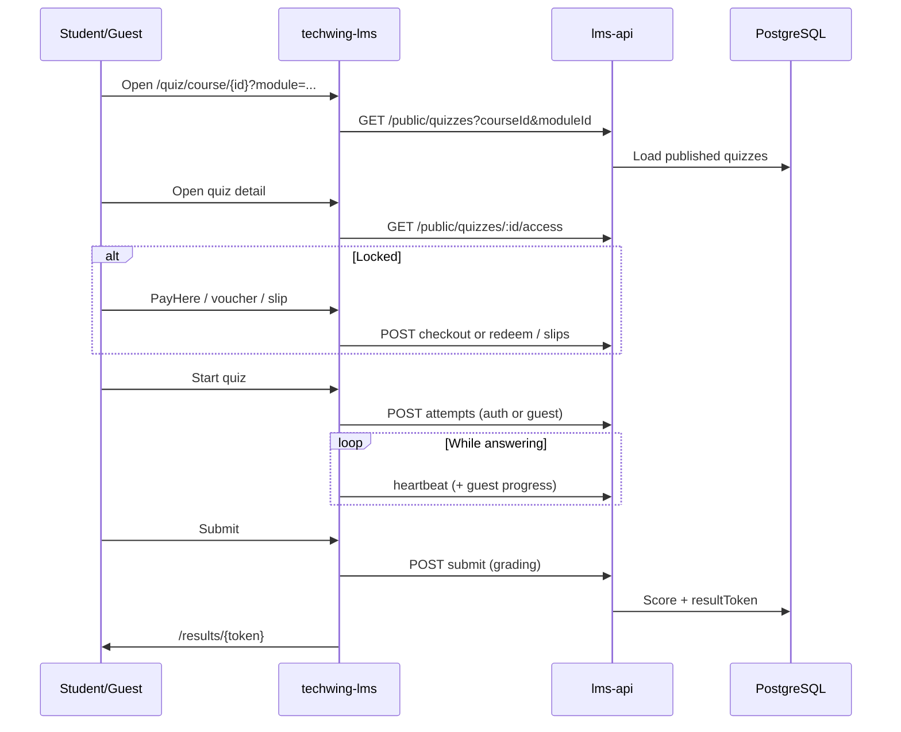

# Kadaima — Module-Based Quiz Portal  
## Technical Design & Delivery Report

| Field | Value |
|-------|--------|
| **Product** | Kadaima — Online Exam & Quiz Portal |
| **Document type** | Client technical report |
| **Version** | 1.0 |
| **Date** | 23 July 2026 |
| **Repositories** | Frontend: `techwing-lms` · Backend: `lms-api` |
| **Audience** | Client stakeholders, technical reviewers, handover teams |

---

## 1. Executive summary

Kadaima is a **module-based online quiz and exam portal** built for Sri Lankan students, teachers, and platform administrators. The solution delivers:

- A **public quiz catalog** organised by **Course → Module → Quiz**
- Timed, multi-language assessments (English / Sinhala / Tamil)
- Guest and registered student attempts with secure result tokens
- Monetisation via **PayHere**, **monthly subscriptions**, **vouchers**, and **bank-slip review**
- Teacher public landing pages, earnings, and admin operations (users, roles, revenue, backup, SEO, AI tools)

The system is split into two applications that communicate over a REST API:

| Layer | Project | Role |
|-------|---------|------|
| **Frontend (UI)** | `techwing-lms` | Next.js web app — public portal + admin/teacher dashboards |
| **Backend (API)** | `lms-api` | NestJS REST API — business logic, auth, payments, grading, data |

Default local API base: `http://localhost:5425`  
Swagger UI (dev): `{API}/api/docs`

---

## 2. Solution we provide to the user

### 2.1 Problem solved

Schools, tuition teachers, and ed-tech operators need a single platform to:

1. Structure content by **course and module**
2. Publish **practice tests / exams** with timers and pass marks
3. Let students attempt quizzes **without friction** (guest or account)
4. Monetise content (per quiz or monthly plan) with local payment rails
5. Give teachers a branded page and payout visibility
6. Give admins control over users, access, payments, and operations

### 2.2 What end users get

| Persona | What they can do |
|---------|------------------|
| **Student / Guest** | Browse catalog, filter by course/module, unlock paid quizzes, take timed quizzes, view results, AI feedback on wrong answers, track in-progress & history, manage profile & payment history |
| **Teacher / Instructor** | Build courses, modules, question bank & quizzes; customise public teacher page; view earnings & payout profile |
| **Platform Admin** | Users & roles (RBAC), payments ledger, vouchers & slip approval, revenue periods & teacher payouts, settings (billing, SEO, email/SMS, AI), database backup, audit logs |

### 2.3 Core product flow (module-based quizzes)

```
Course
  └── Module(s)          ← optional grouping (e.g. “Algebra”, “Week 3”)
        └── Quiz(zes)    ← timed assessment with questions / sections
              └── Attempt → Auto-grade → Result token (+ optional AI review)
```

**Student journey**

1. Open public catalog (home) or course page  
2. Filter quizzes by **module**  
3. Open quiz detail (duration, pass %, price/lock)  
4. Unlock if required (PayHere / subscription / voucher / bank slip)  
5. Start attempt (login **or** guest lead: name, school, mobile)  
6. Answer under server-authoritative timer + anti-cheat heartbeats  
7. Submit → score & pass/fail → shareable `/results/{token}`  
8. Optional AI explanation for incorrect answers  

---

## 3. Technology stack

### 3.1 Frontend — `techwing-lms`

| Area | Technology | Version (package) |
|------|------------|-------------------|
| Framework | **Next.js** (App Router, React Compiler) | ^16.2.9 |
| UI library | **React** / React DOM | ^19.2.7 |
| Language | **TypeScript** | ^5.9.3 |
| Styling | **Tailwind CSS 4** + tw-animate-css | ^4.1.5 |
| Components | **shadcn** + Radix UI + Base UI | shadcn ^4.11.0 |
| Forms / validation | React Hook Form + Zod | ^7.80.0 / ^4.4.3 |
| Client state | Zustand | ^5.0.14 |
| Tables | TanStack Table | ^8.21.3 |
| Charts | Recharts | ^3.8.0 |
| Rich text | TipTap | ^3.27.4 |
| Auth (browser) | JWT in `session_token` cookie + Google OAuth (`@react-oauth/google`) | — |
| HTTP | Native `fetch` against `NEXT_PUBLIC_API_URL` | — |
| Payments UI | PayHere browser SDK (`payhere.lk`) | CDN |
| Lint / quality | Biome + Husky + lint-staged | — |

**Key env (frontend)**

| Variable | Purpose |
|----------|---------|
| `NEXT_PUBLIC_API_URL` | Backend base URL |
| `NEXT_PUBLIC_SITE_URL` | Canonical site URL |
| `NEXT_PUBLIC_GOOGLE_CLIENT_ID` | Google Sign-In |
| `NEXT_PUBLIC_WHATSAPP_NUMBER` | Support WhatsApp deep link |

### 3.2 Backend — `lms-api`

| Area | Technology | Version (package) |
|------|------------|-------------------|
| Runtime | **Node.js** | LTS recommended |
| Framework | **NestJS** | ^11.0.1 |
| Language | **TypeScript** | ^5.7.3 |
| ORM / DB | **Prisma** + **PostgreSQL** | Prisma ^5.22.0 |
| Auth | Passport JWT, bcrypt, Google Auth Library, otplib (2FA) | — |
| Authorisation | **CASL** (`@casl/ability`) + custom roles / permission sets | ^7.0.0 |
| API docs | Swagger (`@nestjs/swagger`) at `/api/docs` | ^11.4.4 |
| Validation | class-validator / class-transformer + Joi (config) | — |
| Rate limit | `@nestjs/throttler` | ^6.5.0 |
| Jobs | `@nestjs/schedule` + Event Emitter | — |
| Email | Nodemailer (SMTP) | ^9.0.3 |
| SMS | Hutch / Notify.lk gateways | Configurable |
| AI | Google **Gemini** (`@google/generative-ai`) — PDF question import & quiz review | ^0.24.1 |
| Payments | **PayHere** (sandbox / live) + vouchers + bank slips | — |
| Files | Local `uploads/` (multer), served at `/uploads/` | — |
| Spreadsheets | xlsx (import/export) | ^0.18.5 |

**Key env (backend) — names only**

| Variable | Purpose |
|----------|---------|
| `DATABASE_URL` | PostgreSQL connection |
| `JWT_SECRET` | Token signing |
| `PORT` | API port (default 5425) |
| `FRONTEND_URL` | CORS / redirect base |
| `PAYHERE_MERCHANT_ID` / `SECRET` / `MODE` / `NOTIFY_URL` | PayHere |
| `SMTP_*` | Transactional email |
| `SMS_GATEWAY_PROVIDER`, Hutch / Notify keys | SMS |
| `GOOGLE_CLIENT_ID` | Google login audience |
| `AI_PROVIDER` / `AI_API_KEY` / `AI_MODEL*` | Gemini |

### 3.3 Infrastructure pattern

```
Browser (Next.js)
       │  HTTPS / REST  + Bearer JWT
       ▼
NestJS API  ── Prisma ── PostgreSQL
       │
       ├── PayHere notify webhook
       ├── SMTP / SMS gateways
       ├── Gemini AI
       └── /uploads static files
```

---

## 4. System architecture

### 4.1 Frontend route map

| Area | Example routes | Purpose |
|------|----------------|---------|
| Marketing | `/`, `/about`, `/contact`, `/faq`, `/terms`, … | Public site |
| Auth | `/login`, `/student/register`, `/teacher/register`, forgot/reset | Accounts |
| Quiz portal | `/quiz/[id]`, `/quiz/[id]/take`, `/quiz/course/[courseId]`, `/quiz/in-progress`, `/quiz/my-attempts` | Catalog & attempts |
| Results | `/results/[token]` | Shareable scored result |
| Teacher page | `/t/[slug]` | Public teacher landing |
| Admin / Teacher UI | `/admin/*` (and `/teacher/*` rewrite) | Dashboard |

Dashboard access is gated by `GET /dashboard/menu` + `GET /dashboard/permissions`.

### 4.2 Backend module map

| Nest module | Responsibility |
|-------------|----------------|
| `auth` | Register, login, Google, 2FA, password reset, profile |
| `users` / `access-control` | Users, custom roles, permission sets, access reviews |
| `course` | Courses + nested modules CRUD, import/export |
| `question` | Question bank, images, AI PDF import, import/export |
| `quiz` | Quiz authoring, attempts, heartbeat, public catalog |
| `grading` | Submit & auto-score attempts |
| `payments` | PayHere, subscription, vouchers, slips, admin ledger |
| `teachers` | Teacher profile, banners, classes, posters, inquiries |
| `revenue` | Period calculation, settle, teacher payouts |
| `dashboard` / `analytics` | Overview stats, quiz analytics |
| `settings` | Billing, notifications, SEO, AI support config |
| `backup` / `audit` | DB backup/restore, audit logs |
| `support-chat` | Public support chat endpoint |

### 4.3 Content model (module-based)

| Entity | Rule |
|--------|------|
| **Course** | Top-level subject / programme container |
| **Module** | Ordered section under a course (optional for quizzes) |
| **Quiz** | Always belongs to a **course**; optionally to a **module** |
| **Question** | Bank item; types: MCQ, SHORT_TEXT, NUMERIC, SEQUENCE, ESSAY |
| **QuizSection** | Optional passage/instruction grouping questions inside a quiz |
| **QuizAttempt** | Student/guest run with timer, responses, score, `resultToken` |

Deleting a **module** does **not** delete quizzes — `moduleId` is set to `null`. Deleting a **course** cascades modules and quizzes.

---

## 5. Features & business capabilities

### 5.1 Multilingual content

- Content languages: **en**, **si**, **ta**
- Quiz titles, descriptions, questions, and choices stored as localised JSON
- Quiz declares which languages it supports; authoring validates coverage

### 5.2 Assessment engine

| Capability | Detail |
|------------|--------|
| Duration | Configurable minutes (minimum 5) |
| Pass mark | 1–100% (default 70%) |
| Max attempts | 1–50 (default 1); resume in-progress if time remains |
| Shuffle | Optional question shuffle (section order fixed) |
| Timer | Server-authoritative `secondsRemaining` + heartbeats |
| Anti-cheat | Tab-blur pause; max **3** violations → auto-submit |
| Guest mode | Lead capture + `guestSessionId`; progress sync / offline queue on frontend |
| Scoring | Auto-grade MCQ / text / numeric / sequence; essays flagged for manual review |
| Results | UUID `resultToken` public page; correct answers hidden while in progress |
| AI review | Gemini explains incorrect answers (throttled) |

### 5.3 Monetisation & unlock

Configurable payment modes:

| Mode | Behaviour |
|------|-----------|
| **MIXED** | Monthly subscription **and/or** per-quiz purchase |
| **MONTHLY_ONLY** | Subscription unlocks eligible quizzes |
| **QUIZ_ONLY** | Per-quiz unlock required for locked quizzes |

Unlock methods:

1. **PayHere** (card / local methods via PayHere)  
2. **Monthly subscription** (+30 days on success)  
3. **Voucher codes** (admin-issued, optional quiz scope & redemption limits)  
4. **Bank slip upload** → admin approve/reject  

### 5.4 Teacher marketplace features

- Custom public page (`/t/{slug}`) with banners, classes, posters, contact inquiries  
- Quiz visibility on teacher page (all or selected)  
- Admin review of teacher page status (Pending / Active / Rejected)  
- Revenue share periods and teacher earnings / payout profile  

### 5.5 Platform operations

- RBAC: SUPER_ADMIN / CUSTOMER_ADMIN / USER + custom roles & permission sets (CASL)  
- Email + SMS notification settings (Hutch / Notify.lk)  
- SEO / branding settings  
- AI support-chat configuration  
- Database backup & restore  
- Audit logging  

---

## 6. Security

| Control | Implementation |
|---------|----------------|
| Authentication | JWT Bearer (`Authorization` header from `session_token` cookie) |
| Passwords | bcrypt hashed; Google-only accounts allowed without local password |
| 2FA | TOTP (otplib) optional |
| Authorisation | CASL abilities + dashboard menu filtering |
| Input validation | Global ValidationPipe (whitelist + transform) |
| Rate limiting | Nest Throttler on sensitive routes |
| Payment notify | PayHere MD5 signature verification |
| Attempt integrity | Server clock for timer; client cannot increase remaining time |
| Secrets | Stored in environment variables (never in client bundles for secret keys) |

---

## 7. Frontend ↔ Backend API mapping

Base URL: `{API}` = `NEXT_PUBLIC_API_URL` (e.g. `https://api.kadaima.com` or `http://localhost:5425`).

Unless noted **Public**, endpoints expect `Authorization: Bearer <token>`.

### 7.1 Auth

| Frontend usage | Method | Endpoint |
|----------------|--------|----------|
| Login | POST | `/auth/login` |
| 2FA verify | POST | `/auth/2fa/verify` |
| Google Sign-In | POST | `/auth/google` |
| Student register | POST | `/auth/register/student` |
| Teacher register | POST | `/auth/register/teacher` |
| Generic register | POST | `/auth/register` |
| Forgot password | POST | `/auth/forgot-password` |
| Validate reset token | POST | `/auth/validate-reset-token` |
| Reset password | POST | `/auth/reset-password` |
| Current user | GET | `/auth/me` |
| Update profile | PATCH | `/auth/me` |
| Change password | POST | `/auth/change-password` |

### 7.2 Public quiz portal

| Frontend usage | Method | Endpoint |
|----------------|--------|----------|
| Catalog / home / sitemap | GET | `/public/quizzes` |
| Catalog search index | GET | `/public/quizzes/catalog-index` |
| Quizzes by course (+ module filter) | GET | `/public/quizzes?courseId=&moduleId=` |
| Quiz detail | GET | `/public/quizzes/:id` |
| Access / unlock check | GET | `/public/quizzes/:id/access` |
| Guest in-progress | GET | `/public/quizzes/in-progress` |
| Guest attempt history | GET | `/public/quizzes/my-attempts` |
| Start guest attempt | POST | `/public/quizzes/:id/guest-attempts` |
| Save guest progress | PUT | `/public/quizzes/attempts/:id/progress` |
| Guest heartbeat | POST | `/public/quizzes/attempts/:id/heartbeat` |
| Guest submit | POST | `/public/quizzes/attempts/:id/submit` |
| Public result | GET | `/public/quizzes/results/:token` |
| AI review (token) | POST | `/public/quizzes/results/:token/ai-review` |
| Public SEO | GET | `/public/settings/seo` |
| Monthly fee / mode | GET | `/public/billing/monthly-fee` |

### 7.3 Authenticated quiz attempts & grading

| Frontend usage | Method | Endpoint |
|----------------|--------|----------|
| Start / resume attempt | POST | `/quizzes/:id/attempts` |
| My latest attempt | GET | `/quizzes/:id/my-attempt` |
| Attempt detail | GET | `/quizzes/attempts/:attemptId` |
| Heartbeat | POST | `/quizzes/attempts/:attemptId/heartbeat` |
| Submit (authed) | POST | `/grading/attempts/:attemptId/submit` |
| In-progress list | GET | `/quizzes/me/in-progress` |
| Attempt history | GET | `/quizzes/me/attempts` |
| AI review (attempt) | POST | `/quizzes/attempts/:attemptId/ai-review` |
| Published “My Quizzes” | GET | `/quizzes?status=Published` |

### 7.4 Courses & modules (admin / teacher)

| Frontend usage | Method | Endpoint |
|----------------|--------|----------|
| List / CRUD courses | GET/POST/PUT/PATCH/DELETE | `/courses`, `/courses/:id`, `/courses/:id/status` |
| Bulk status / delete | PATCH/POST | `/courses/bulk/status`, `/courses/bulk/delete` |
| Export / import | GET/POST | `/courses/export`, `/courses/import` |
| List / CRUD modules | GET/POST/PUT/PATCH/DELETE | `/courses/:courseId/modules`, `.../modules/:id` |
| Module bulk / export / import | PATCH/POST/GET | `.../modules/bulk/*`, `.../modules/export`, `.../modules/import` |
| Quiz builder course picker | GET | `/quizzes/courses` |

### 7.5 Quizzes & questions (admin / teacher)

| Frontend usage | Method | Endpoint |
|----------------|--------|----------|
| Manage quizzes | GET/POST/PUT/PATCH/DELETE | `/quizzes`, `/quizzes/:id`, `/quizzes/:id/status` |
| Bulk / export / import | PATCH/POST/GET | `/quizzes/bulk/*`, `/quizzes/export`, `/quizzes/import` |
| Cover upload | POST | `/quizzes/upload-cover` |
| Question bank CRUD | GET/POST/PUT/PATCH/DELETE | `/questions`, `/questions/:id`, … |
| Bulk / export / import | PATCH/POST/GET | `/questions/bulk/*`, `/questions/export`, `/questions/import` |
| Image upload | POST | `/questions/upload-image` |
| AI PDF → questions | POST | `/questions/ai/import-pdf` |

### 7.6 Payments

| Frontend usage | Method | Endpoint |
|----------------|--------|----------|
| Subscription status | GET | `/public/payments/subscription/status` |
| My payments | GET | `/public/payments/my` |
| Subscription checkout | POST | `/public/payments/subscription/checkout` |
| Per-quiz PayHere checkout | POST | `/public/payments/payhere/checkout` |
| Sandbox complete (local) | POST | `/public/payments/payhere/sandbox-complete` |
| Redeem voucher | POST | `/public/payments/voucher/redeem` |
| Upload bank slip | POST | `/public/payments/slips` |
| PayHere webhook | POST | `/payments/payhere/notify` |
| Admin ledger / vouchers / slips | GET/POST/PATCH | `/payments/admin/*` |

### 7.7 Teachers

| Frontend usage | Method | Endpoint |
|----------------|--------|----------|
| Public profile | GET | `/public/teachers/:slug` |
| Public teacher quizzes | GET | `/public/teachers/:slug/quizzes` |
| Contact inquiry | POST | `/public/teachers/:slug/inquiries` |
| My profile / media / banners / classes / posters / inquiries | GET/PUT/POST/PATCH/DELETE | `/teachers/me/*` |
| Earnings / payout profile | GET/PUT | `/teacher/earnings`, `/teacher/payout-profile` |

### 7.8 Users, roles, dashboard, settings, ops

| Area | Key endpoints |
|------|----------------|
| Users | `GET/POST/PATCH/DELETE /users`, invite, soft-delete, activate-teacher |
| Roles & permissions | `/roles`, `/permission-sets`, `/access-reviews` |
| Dashboard | `/dashboard/menu`, `/dashboard/permissions`, `/dashboard/overview`, `/dashboard/stats` |
| Analytics | `/analytics/quizzes`, `/analytics/difficult-questions` |
| Settings | `/settings/billing`, `/settings/notifications`, `/settings/seo`, `/settings/ai` |
| Revenue | `/revenue/periods`, settle, mark-paid, `/revenue/payouts/:id` |
| Backup | `/backup`, download, restore, upload restore |
| Audit | `/audit-logs`, `/audit-logs/settings` |
| Support | `POST /support/chat` |

**Static media:** `{API}/uploads/...` (covers, question images, slips, teacher media).

---

## 8. End-to-end sequences

### 8.1 Take a module quiz (public)



### 8.2 Unlock with PayHere

1. Frontend calls checkout API → receives PayHere payment object  
2. Browser opens PayHere checkout  
3. PayHere calls `POST /payments/payhere/notify` (must be publicly reachable; use ngrok locally)  
4. API verifies signature → marks order Paid → grants `QuizUnlock`  
5. Student can start the quiz  

Local sandbox without webhook: `POST /public/payments/payhere/sandbox-complete`.

---

## 9. Data model (summary)

**Core**

- `Workspace`, `User`, `CustomRole`, `Permission`, `PermissionSet`  
- `Course` → `Module` → optional link to `Quiz`  
- `Question` + `AnswerChoice` ↔ `QuizQuestion` / `QuizSection`  
- `QuizAttempt` + `StudentResponse`  

**Commerce**

- `PaymentOrder`, `QuizUnlock`, `UnlockVoucher`, `PaymentSlipSubmission`, `StudentSubscription`  

**Teacher / ops**

- Teacher profile entities (banners, classes, posters, inquiries)  
- Revenue periods & payouts  
- `SystemSetting`, audit logs, backups  

Database: **PostgreSQL** via Prisma migrations/seed scripts (`db:seed`, `db:clean-content`).

---

## 10. Deployment & environments

| Concern | Guidance |
|---------|----------|
| Frontend | Next.js build (`next build` / `next start`); set `NEXT_PUBLIC_API_URL` to production API |
| Backend | `nest build` → `node dist/main`; set `PORT`, `DATABASE_URL`, secrets |
| Database | Managed PostgreSQL recommended |
| Uploads | Persist `uploads/` volume or migrate to object storage if scaling |
| PayHere | Live merchant credentials; `PAYHERE_NOTIFY_URL` must be HTTPS public URL |
| CORS | API allows configured frontend origin(s) |
| Docs | Swagger at `{API}/api/docs` for integrator reference |

**Suggested environments:** Development → Staging (sandbox PayHere) → Production (live PayHere).

---

## 11. Deliverables checklist (for client)

| Deliverable | Status in codebase |
|-------------|-------------------|
| Module-based course / quiz portal (public) | Implemented |
| Timed attempts + anti-cheat heartbeats | Implemented |
| Multilingual quizzes (en/si/ta) | Implemented |
| Guest + registered student flows | Implemented |
| Question bank + quiz builder + sections | Implemented |
| AI PDF import & AI wrong-answer review | Implemented |
| PayHere + subscription + voucher + slip | Implemented |
| Teacher public pages & earnings | Implemented |
| Admin RBAC, payments, revenue, backup, audit | Implemented |
| Frontend ↔ API integration (mapped above) | Implemented |
| API documentation (Swagger) | Available at `/api/docs` |

---

## 12. Repository reference

| Component | Path |
|-----------|------|
| Frontend | `d:\Personal\Projects\techwing-lms` |
| Backend API | `d:\Personal\Projects\lms-api` |
| This report | `d:\Personal\Projects\lms-api\docs\Kadaima-Technical-Report.md` |
| Prisma schema | `lms-api/prisma/schema.prisma` |
| Frontend config | `techwing-lms/src/config/app-config.ts` |

---

## 13. Glossary

| Term | Meaning |
|------|---------|
| **Module** | Ordered subunit of a course used to group quizzes |
| **Unlock** | Entitlement granting access to a locked quiz |
| **Attempt** | One timed run of a quiz by a user or guest |
| **Result token** | Public UUID used to view scored results without admin access |
| **Heartbeat** | Periodic client→server call that advances/freezes the authoritative timer |
| **Guest session** | Browser-scoped ID allowing attempts without full registration |

---

*End of technical report.*  
*Prepared for client handover — Kadaima module-based quiz portal (techwing-lms + lms-api).*
